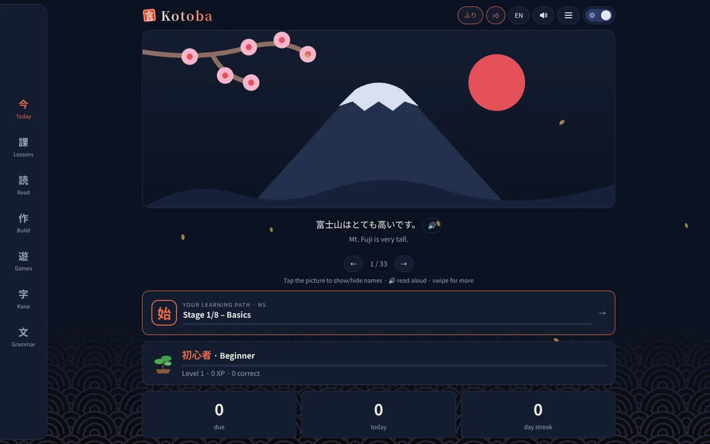
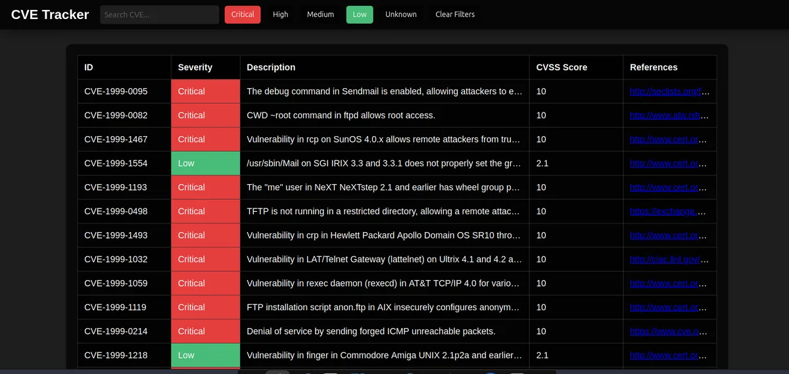

# 🐼 Panda – hobby projects
Source of **<https://cyberpanda.github.io>** – free-time AI projects, shared as a hobby. Contributions welcome.
Source of **<https://cyberpanda.github.io>** – my apps and web experiments.

| Project | What it is | Open |
|---|---|---|
| **Kotoba 言葉** | Learn Japanese – lessons, learning path to JLPT N5, games, RPG, chill modes. Offline, no tracking. Native apps for iOS, Android, macOS, Windows, Linux in the [kotoba repo](https://github.com/cyberpanda/kotoba). | [kotoba.html](https://cyberpanda.github.io/kotoba.html) |
| **CYBA Delta** | Quiet automation for security operations – flows, templates, per-customer profiles. Live demo runs fully in the browser (no backend). Source: [cyba-delta](https://github.com/cyberpanda/cyba-delta). | [cyba-delta/](https://cyberpanda.github.io/cyba-delta/) |
| **CVE Table** | Live search of the NIST NVD: newest CVEs, CVSS 4/3/2, CISA KEV, CWE, affected products, references, CSV/JSON export, shareable filters, responsive table/cards. | [cve.html](https://cyberpanda.github.io/cve.html) |
| **Liquid Glass** | Early WebGL recreation of Apple’s Liquid Glass, built when it came out – now optimized (renders on demand, capped resolution, touch). Fan project – not affiliated with Apple. | [liquid-glass.html](https://cyberpanda.github.io/liquid-glass.html) |

<p align="center">
  
  
</p>

## Contributing

These are free-time projects built with AI and shared as a hobby. Everyone is welcome to use them and to join in: open an issue with ideas or bugs, or send a pull request.

## Structure

```
index.html            landing page (showcase + interactive terminal)
kotoba.html           Kotoba – complete app in one file
kotoba.webmanifest    ┐
kotoba-sw.js          │ Kotoba extras: “Install app” on Android/desktop + offline cache
kotoba-icon-*.png     ┘
cyba-delta/           CYBA Delta live demo (web UI + demo/mock.js in-browser backend)
cve.html              CVE Table
liquid-glass.html     Liquid Glass
404.html              not-found page
tools/cyba-delta-demo/ rebuilds the CYBA Delta demo backend (mock.js)
assets/               css, js, screenshots
favicon.svg  robots.txt  sitemap.xml  .nojekyll
```

No build step – GitHub Pages serves the files as they are (branch `main`, folder `/`).

### Updating Kotoba

`kotoba.html` and the Kotoba extras come from the release build of
[cyberpanda/kotoba](https://github.com/cyberpanda/kotoba) (`dist/standalone/`). The kotoba release
workflow updates them here automatically when the secret `PAGES_DEPLOY_TOKEN` is set; otherwise copy
them from the release zip `kotoba-standalone-x.y.z.zip`.

## Notes

- Liquid Glass is a fan-made experiment; *Liquid Glass* design, Apple and related marks belong to
  Apple Inc. Its background photo is loaded from Unsplash.
- CVE data comes from the [NVD](https://nvd.nist.gov/developers) API of NIST. This product uses the
  NVD API but is not endorsed or certified by the NVD.

## License

[BSD 3-Clause](LICENSE) for the code of this site. Kotoba has its own [license and credits](https://github.com/cyberpanda/kotoba).

### Updating the CYBA Delta demo

`cyba-delta/` is the `web/` folder of [cyba-delta](https://github.com/cyberpanda/cyba-delta) plus
`demo/mock.js` (answers the `/api` routes in the browser with ports of the engine’s validation,
dry-run runtime, templates, profiles, mappings and OpenAPI import; state is kept in `localStorage`,
“Reset demo” restores it) and `demo/demo.css`. To update: copy the new `web/` files over, keep
`demo/` and the two lines in `index.html` that load it.
